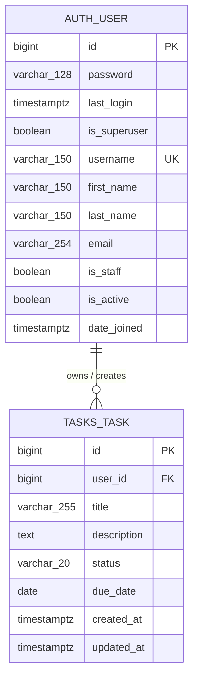

# Thiết kế cơ sở dữ liệu — Cloud Task Manager

> **Phạm vi:** tài liệu hóa thiết kế hiện có, không thiết kế lại và không tạo bảng mới.  
> **Ngày kiểm tra:** 2026-11-09  
> **Nguồn đã đọc:** `tasks/models.py`, `tasks/migrations/0001_initial.py`, `config/settings.py`, `docker-compose.yml`, `docs/reports/step-10c-docker-handoff-fixes.md`.

## 1. Tóm tắt kiến trúc

Cloud Task Manager sử dụng **PostgreSQL 16** làm cơ sở dữ liệu quan hệ. Django là tầng ORM và quản lý thay đổi schema bằng migrations. Trong cấu hình hiện tại:

- `config/settings.py` bắt buộc biến `DATABASE_URL` theo dạng PostgreSQL URL và chuyển URL đó thành cấu hình Django bằng `dj_database_url.parse(...)`.
- `docker-compose.yml` định nghĩa dịch vụ `db` từ image `postgres:16-alpine`.
- Dịch vụ `app` kết nối tới host Docker `db`, port PostgreSQL `5432`, rồi chạy `python manage.py migrate --noinput` khi khởi động.
- Volume có tên `postgres_data` được gắn vào `/var/lib/postgresql/data`; vì vậy dữ liệu PostgreSQL nằm ngoài vòng đời riêng của container database. Xóa/recreate container không đồng nghĩa với xóa volume.
- `TIME_ZONE = 'UTC'` và `USE_TZ = True`; các trường ngày giờ của Django được lưu theo semantics timezone-aware của PostgreSQL.

Sơ đồ logic chính chỉ gồm hai thực thể nghiệp vụ:



`||--o{` biểu diễn quan hệ **một User — nhiều Task**: một người dùng có thể có 0 hoặc nhiều task; mỗi task bắt buộc thuộc về đúng một user. `on_delete=models.CASCADE` nghĩa là xóa user sẽ xóa các task liên quan.

## 2. Django ORM và migrations

Model `Task` trong `tasks/models.py` là nguồn mô tả nghiệp vụ. Migration `tasks/migrations/0001_initial.py` là biểu diễn bất biến của lần tạo bảng đầu tiên, phụ thuộc vào model user có thể thay thế của Django (`settings.AUTH_USER_MODEL`). Django dùng migration graph để áp dụng tuần tự thay đổi schema; ứng dụng migration được ghi nhận trong bảng hệ thống `django_migrations`.

Một số điểm cần phân biệt:

- Model Python không tự động là bằng chứng runtime của một database đang chạy; runtime cần được kiểm tra bằng SQL introspection.
- Migration hiện có tạo `tasks_task`, nhưng không tạo `auth_user` vì `auth_user` thuộc migration của ứng dụng `django.contrib.auth`.
- `DEFAULT_AUTO_FIELD = 'django.db.models.BigAutoField'`, nên khóa chính do Django tự thêm cho `Task` là số nguyên 64-bit (`bigint`) trong PostgreSQL.
- Các lựa chọn trạng thái được lưu bằng giá trị ổn định `pending` hoặc `completed`; nhãn hiển thị được dịch riêng và không làm thay đổi dữ liệu lưu trữ.
- `Meta.ordering = ['-created_at']` là thứ tự mặc định ở tầng ORM, **không phải** một constraint hay một thứ tự vật lý của PostgreSQL.

## 3. Từ điển dữ liệu chính

### 3.1. `auth_user`

Đây là bảng user chuẩn của `django.contrib.auth`, được model `django.contrib.auth.models.User` sử dụng. Mô tả dưới đây là schema Django chuẩn tương ứng với phiên bản dự án; trạng thái runtime của database phiên này chưa thể xác nhận vì lệnh SQL bị BLOCKED (xem mục 5).

| Cột | PostgreSQL | Null | Mặc định/đặc tính | Vai trò |
|---|---|---:|---|---|
| `id` | `bigint` | Không | primary key, tự sinh | Định danh user |
| `password` | `varchar(128)` | Không | — | Chuỗi hash mật khẩu; không phải mật khẩu rõ |
| `last_login` | `timestamp with time zone` | Có | `NULL` | Lần đăng nhập gần nhất |
| `is_superuser` | `boolean` | Không | `false` ở tầng Django | Toàn quyền qua permission system |
| `username` | `varchar(150)` | Không | unique | Tên đăng nhập |
| `first_name` | `varchar(150)` | Không | chuỗi rỗng ở tầng Django | Tên |
| `last_name` | `varchar(150)` | Không | chuỗi rỗng ở tầng Django | Họ |
| `email` | `varchar(254)` | Không | chuỗi rỗng ở tầng Django | Email |
| `is_staff` | `boolean` | Không | `false` ở tầng Django | Được phép vào admin |
| `is_active` | `boolean` | Không | `true` ở tầng Django | Trạng thái tài khoản |
| `date_joined` | `timestamp with time zone` | Không | thời điểm tạo user ở tầng Django | Ngày tham gia |

Ràng buộc/index liên quan: `id` là khóa chính; `username` là duy nhất và PostgreSQL duy trì unique index tương ứng. Các permission/group relation của Django được đặt ở các bảng phụ, không nằm trong ERD nghiệp vụ tối giản này.

### 3.2. `tasks_task`

Bảng này được tạo bởi migration `tasks 0001_initial` từ model `Task`.

| Cột | PostgreSQL | Null | Mặc định/đặc tính | Nguồn/ý nghĩa |
|---|---|---:|---|---|
| `id` | `bigint` | Không | primary key, tự sinh | `BigAutoField` mặc định |
| `user_id` | `bigint` | Không | foreign key tới `auth_user(id)` | `ForeignKey(User, on_delete=CASCADE)` |
| `title` | `varchar(255)` | Không | — | Tiêu đề task |
| `description` | `text` | Không | `''` | Mô tả; `blank=True` là validation, `default=''` là giá trị mặc định |
| `status` | `varchar(20)` | Không | `'pending'` | Chỉ nhận logic choices `pending`/`completed` ở tầng model |
| `due_date` | `date` | Có | `NULL` | Hạn hoàn thành tùy chọn |
| `created_at` | `timestamp with time zone` | Không | tự ghi lúc tạo | `auto_now_add=True` |
| `updated_at` | `timestamp with time zone` | Không | tự cập nhật khi lưu | `auto_now=True` |

Ràng buộc/index:

- Khóa chính: `tasks_task.id`.
- Khóa ngoại bắt buộc: `tasks_task.user_id` tham chiếu `auth_user.id`; xóa user theo cascade.
- Index ghép theo migration: `tasks_task_user_id_c0fce1_idx` trên `(user_id, status)`.
- Index ghép theo migration: `tasks_task_user_id_d01da7_idx` trên `(user_id, created_at DESC)`; dấu `-` trong `models.Index(fields=['user', '-created_at'])` yêu cầu thứ tự giảm cho cột thời gian.
- Django không khai báo unique constraint cho `title`, `status` hoặc `due_date`; nhiều task có thể có cùng các giá trị này.

## 4. Các bảng hệ thống Django

Ngoài hai bảng nghiệp vụ chính, khi chạy toàn bộ migrations của các app trong `INSTALLED_APPS`, Django thường có thêm:

- `django_migrations`: nhật ký migration đã áp dụng.
- `django_content_type`: ánh xạ app/model cho permission framework.
- `auth_group`, `auth_permission`: nhóm và quyền.
- `auth_user_groups`, `auth_user_user_permissions`: bảng nối many-to-many của user với group/quyền.
- `django_session`: session server-side nếu dùng database session backend.

Các bảng này là hạ tầng framework, không phải bảng nghiệp vụ task. Bảng admin/log hoặc các bảng khác chỉ xuất hiện tùy migration/backend được bật; không nên đưa vào sơ đồ chính nếu chưa kiểm tra runtime.

## 5. SQL schema và trạng thái kiểm chứng runtime

### Kết quả trích xuất SQL

**BLOCKED — chưa có SQL schema runtime được lưu.** Lệnh yêu cầu đã được chạy đúng trong thư mục repository:

```text
./.venv/Scripts/python.exe manage.py sqlmigrate tasks 0001
```

Kết quả: **exit code 1**. Django dừng khi đọc cấu hình vì shell hiện tại không có biến bắt buộc `SECRET_KEY`; Docker daemon cũng không kết nối được để kiểm tra stack. Không sử dụng SQLite và không tự dựng SQL thay thế. Vì vậy không có file `docs/database/tasks-0001.sql` được coi là bằng chứng đã xác minh.

Khi môi trường PostgreSQL đã được nạp đúng (không in secret ra terminal), chạy chính xác lệnh sau từ thư mục repository:

```powershell
.\.venv\Scripts\python.exe manage.py sqlmigrate tasks 0001 > docs/database/tasks-0001.sql
```

Lệnh trên chỉ xuất SQL mà Django sinh từ migration; nó không áp dụng migration. Chỉ coi file là **SQL-verified** sau khi lệnh kết thúc với exit code 0 và kiểm tra file không chứa thông tin đăng nhập.

### Kiểm tra runtime read-only sau này

Sau khi có kết nối PostgreSQL đang hoạt động, chạy các truy vấn chỉ đọc sau trong pgAdmin/DBeaver hoặc `psql`. Các truy vấn không nhận input bên ngoài nên không có vấn đề ghép chuỗi SQL:

```sql
SELECT table_schema, table_name
FROM information_schema.tables
WHERE table_schema = 'public'
  AND table_name IN ('auth_user', 'tasks_task')
ORDER BY table_name;

SELECT table_name, column_name, ordinal_position, data_type,
       udt_name, is_nullable, column_default
FROM information_schema.columns
WHERE table_schema = 'public'
  AND table_name IN ('auth_user', 'tasks_task')
ORDER BY table_name, ordinal_position;

SELECT tc.table_name, tc.constraint_name, tc.constraint_type,
       kcu.column_name, ccu.table_name AS foreign_table_name,
       ccu.column_name AS foreign_column_name
FROM information_schema.table_constraints AS tc
LEFT JOIN information_schema.key_column_usage AS kcu
  ON tc.constraint_schema = kcu.constraint_schema
 AND tc.constraint_name = kcu.constraint_name
 AND tc.table_name = kcu.table_name
LEFT JOIN information_schema.constraint_column_usage AS ccu
  ON tc.constraint_schema = ccu.constraint_schema
 AND tc.constraint_name = ccu.constraint_name
WHERE tc.constraint_schema = 'public'
  AND tc.table_name IN ('auth_user', 'tasks_task')
ORDER BY tc.table_name, tc.constraint_type, tc.constraint_name;

SELECT schemaname, tablename, indexname, indexdef
FROM pg_indexes
WHERE schemaname = 'public'
  AND tablename IN ('auth_user', 'tasks_task')
ORDER BY tablename, indexname;
```

Các truy vấn trên là bước **runtime verification**; hiện chưa được thực thi trong phiên này. Không có dữ liệu người dùng nào được yêu cầu hoặc ghi vào tài liệu.

## 6. PostgreSQL persistence trong Docker

`docker-compose.yml` cấu hình:

```yaml
services:
  db:
    image: postgres:16-alpine
    volumes:
      - postgres_data:/var/lib/postgresql/data
```

Vì `postgres_data` là named volume, PostgreSQL giữ lại cluster/data directory khi container được thay thế. Trong báo cáo nên trình bày luồng:

1. Docker khởi chạy PostgreSQL 16 và healthcheck `pg_isready` xác nhận database sẵn sàng.
2. App chờ `db` healthy.
3. App chạy Django migrations trước khi Gunicorn phục vụ HTTP.
4. Dữ liệu nghiệp vụ nằm trong volume `postgres_data`, còn static files nằm trong volume riêng `static_volume`.

Không được nhầm volume với cơ chế backup: volume giúp persistence trong Docker host, nhưng vẫn cần backup/restore PostgreSQL riêng cho yêu cầu vận hành.

## 7. Cách trình bày trong báo cáo đại học

Có thể trình bày theo bốn ý ngắn:

1. **Công nghệ:** PostgreSQL 16 là RDBMS; Django ORM ánh xạ class `Task` thành bảng `tasks_task` và dùng foreign key tới user chuẩn `auth_user`.
2. **Toàn vẹn dữ liệu:** primary key định danh bản ghi; foreign key bắt buộc bảo đảm task luôn thuộc user hợp lệ; cascade tránh task mồ côi khi user bị xóa.
3. **Hiệu năng:** hai composite index phục vụ lọc task theo user/trạng thái và sắp xếp task theo thời điểm tạo mới nhất.
4. **Triển khai cloud/container:** migration được chạy tự động khi app container khởi động; named volume PostgreSQL giữ dữ liệu độc lập với container.

Khi chèn ERD vào báo cáo, render khối Mermaid ở mục 1 bằng Mermaid Live Editor hoặc công cụ render Mermaid của hệ thống tài liệu. Khi chèn bằng chứng SQL, dùng file `docs/database/tasks-0001.sql` chỉ sau khi lệnh extraction hoàn tất thành công; nếu chưa, ghi chú rõ **SQL extraction BLOCKED** thay vì dùng SQL tự viết.

## 8. Hướng dẫn chụp ảnh bằng chứng GUI

Hiện phiên này không có GUI PostgreSQL khả dụng. Để tự chụp bằng chứng sạch trong pgAdmin hoặc DBeaver:

1. Kết nối tới database PostgreSQL local bằng profile đã được cấp sẵn; không chụp màn hình phần password/connection secret.
2. Mở schema `public` → Tables → `auth_user`; chụp phần Columns và Constraints/Indexes.
3. Mở `public.tasks_task`; chụp phần Columns, Foreign Keys và Indexes. Bảo đảm không mở tab Data hoặc làm lộ username/email/task thật.
4. Nếu cần ảnh quan hệ, mở ERD tool, chỉ chọn `auth_user` và `tasks_task`, rồi ẩn dữ liệu mẫu.
5. Đặt ảnh vào thư mục báo cáo và ghi thời điểm, công cụ, database/schema; đánh dấu đây là **runtime evidence**.

## 9. Kết luận kiểm tra

- **Source consistency:** PASS — model, migration, ERD và data dictionary thống nhất về hai bảng chính, cột, quan hệ, cascade và hai index của `tasks_task`.
- **SQL extraction:** BLOCKED — exit code 1 do thiếu `SECRET_KEY` trong môi trường thực thi; chưa có SQL file runtime.
- **Runtime table/index comparison:** BLOCKED — Docker daemon không khả dụng và không có cấu hình PostgreSQL runtime trong shell; chưa chạy truy vấn introspection.
- **Database records:** không sửa, không thêm, không xóa.
- **Scope:** chỉ tài liệu hóa và kiểm tra read-only theo yêu cầu.
